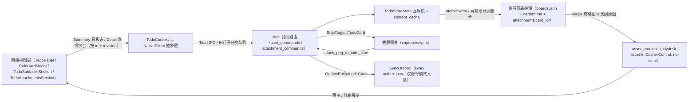
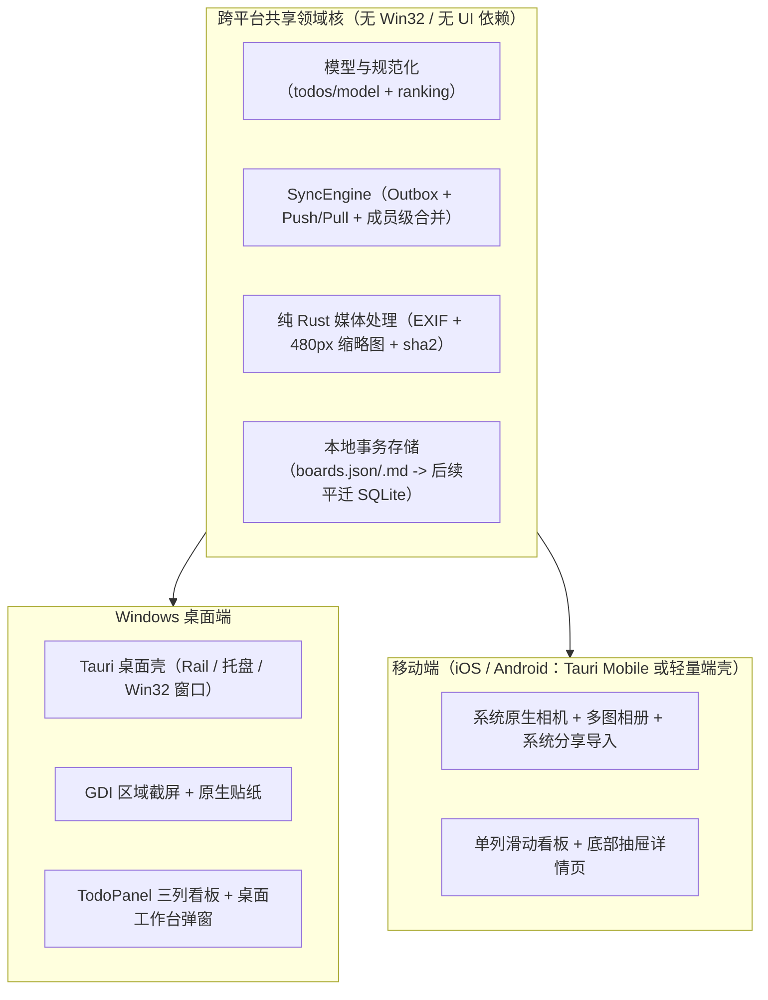
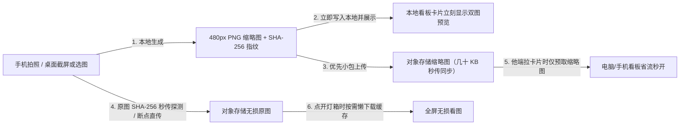

# TidyDesk TODO 数据链路规范与桌面/移动端协同架构指南

> **文档角色**：本文档负责沉淀 TODO 模块的 **端到端数据链路规范、现存跨端同步断层、桌面与移动端统一架构蓝图**。
> - 阶段进度勾选与里程碑排期见施工总表：[TODO 富媒体与多账号协同演进路线图](./TODO_MEDIA_AND_COLLAB_ROADMAP.md)
> - 文档目录总入口见：[TidyDesk 文档中心](../README.md)
>
> **最后更新**：2026-11-23（Phase 2.5 同步前置与跨平台哈希落地，`47/47` Rust 单元测试通过）

---

## 一、 当前 TODO 全链路全景（已实现现状）

桌面端当前已完成“本地离线优先 + 多账号工作区目录隔离 + Outbox 发件箱骨架”的数据闭环：

### 当前已闭环的关键能力
- **摘要与详情隔离投影**：[store.rs](../../src-tauri/src/todos/store.rs) 通过 `enrich_card_summary_view` 向看板列表仅下发 `summaryText`、封面置顶的 `previewAttachments`（最多 2 项）、`extraAttachmentCount`、`subtaskTotal/Completed` 与 `revision`；详情窗通过 `todos_get_card_detail` 按需水合全量 Markdown 正文、`subtasks[]` 与 `attachments[]`。
- **主任务与子任务统一媒体管线**：[attachment_commands.rs](../../src-tauri/src/todos/attachment_commands.rs) 的 `resolve_attachment_list_mut(card, subtask_id)` 让上传、选图、删除、焦点/裁剪模式调整、摄像头拍照、框选截屏与 `Ctrl+V` 粘贴共用同一条存储与 `Outbox` 链路；删子任务或删卡时同步清理磁盘孤儿图片并修正失效封面引用。
- **多维交互与硬件边界防护**：包含新建草稿误触确认、外部拖图防 WebView 劫持、子任务并发串行队列与“新建子任务后立即可拍/截屏”顺序保障、窗体隐藏自动释放摄像头视频流、截屏异常强制恢复 TODO 窗口及前端 `> 20 MB` / `.svg` 前置拦截。
- **多账号工作区隔离**：[accounts/session.rs](../../src-tauri/src/accounts/session.rs) 与 [accounts/commands.rs](../../src-tauri/src/accounts/commands.rs) 隔离纯本地目录与 `accounts/<user_id>/`，切号时清除缓存、`asset_protocol.rs` 返回 `no-store` 防止跨账号污染。

---

## 二、 核查发现的跨端断层清单（同步/移动端上线前必解）

尽管桌面单机体验已完备，当前数据链路对照“云端协同 + 移动端并发使用”存在以下 **5 处真实断层**：

| 编号 | 断层现象 | 代码真实位置 | 对桌面与移动端的影响 | 修复状态 |
| --- | --- | --- | --- | --- |
| **G1** | `OutboxEntityKind::Card` 快照携带正文 `.md` 与 `baseRevision`；`OutboxEntityKind::Attachment` 已接入增/删/删子任务/删卡队列 | [card_commands.rs](../../src-tauri/src/todos/card_commands.rs)、[attachment_commands.rs](../../src-tauri/src/todos/attachment_commands.rs) | 上云后卡片正文与附件文件均可完整推送 | ✅ 已补齐（Phase 2.5） |
| **G2** | `accounts_import_local_todos` 导入旧卡片已批量补写 Outbox；`sync-outbox.json` 满队列改为显式阻断报错（`Fail Loudly`） | [accounts/commands.rs](../../src-tauri/src/accounts/commands.rs)、[outbox.rs](../../src-tauri/src/sync/outbox.rs) | 单机导入账号任务完整进入队列，杜绝静默丢头 | ✅ 已补齐（Phase 2.5） |
| **G3** | Token 通过 Windows DPAPI 加密写入账号隔离目录（零明文），`last_sync_cursor` 与服务端点按账号 `sync-profile.json` 保留 | [credentials.rs](../../src-tauri/src/accounts/credentials.rs)、[accounts/session.rs](../../src-tauri/src/accounts/session.rs) | 切换账号不丢游标，后续真实 HTTPS 同步可直接读取安全 Token | ✅ 已补齐（Phase 2.5） |
| **G4** | 前后端看板列统一采用 `ranking.rs` 的 `position` 字典序单源排序，规范化派生兼容字段 `cardOrder` | [ranking.rs](../../src-tauri/src/todos/ranking.rs)、[TodoContext.tsx](../../src/context/TodoContext.tsx) | 消除手机与电脑同时插卡时的 `cardOrder` 数组冲突 | ✅ 已补齐（Phase 2.5） |
| **G5** | `attachments.rs` 已替换为纯 Rust FIPS 180-4 SHA-256；`asset_protocol.rs` 已支持缺失附件远端懒下载，服务端 MVP 与预取回写已落地 | [attachments.rs](../../src-tauri/src/todos/attachments.rs)、[asset_protocol.rs](../../src-tauri/src/asset_protocol.rs)、[engine.rs](../../src-tauri/src/sync/engine.rs) | 桌面端已打通「缩略图预取 + 灯箱原图懒加载」全链路 | ✅ 已落地（Phase 3） |

---

## 三、 桌面端 + 移动端协同目标架构

### 1. 工程结构分层：纯跨平台领域核 + 端差异壳层

- **后端剥离策略**：将 `src-tauri/src/todos/{model,ranking}`、`sync/`、`accounts/` 从 Win32 API 中解放（首步把 [attachments.rs](../../src-tauri/src/todos/attachments.rs) 的 `BCrypt` 替换为纯 Rust `sha2` crate），让截屏（`capture/`）、桌面贴纸（`stickers/`）、快捷方式抽屉（`files/`、`shortcuts/`）留在桌面特性门控（feature / `cfg(desktop)`）下。
- **前端 `NativeClient` 与能力开关（Capabilities）**：
  - 保留 [TodoContext.tsx](../../src/context/TodoContext.tsx) 作为无平台假设的状态中枢，为 `NativeClient` 扩充 `capabilities` 描述（如 `canScreenSnip`、`canUseHotkeys`、`platformLayout`）；
  - 手机端隐藏“区域截屏”按钮，仅保留拍照、相册选图与内嵌预览，共用同一套 `addAttachmentBytes`、校验工具与灯箱逻辑。

---

### 2. 多端增量同步与冲突合并规约

1. **登录与数据拉取严格隔离**：
   - 登录态接口仅校验并签发 `User ID + Token`，令牌按端分别存入安全凭据存储（Windows Credential Manager / Android Keystore / iOS Keychain），`last_sync_cursor` 与 `server_endpoint` 按账号工作区持久化保留；
   - **禁止登录动作阻塞或直接拉取业务数据**；一切数据推拉在登录成功后由异步 `SyncEngine` 独立运行，服务端依据权限矩阵校验访问边界。
2. **排序单源化（零列顺序冲突）**：
   - 桌面与移动端均改用未删除卡片的 `(columnId, position, createdAt)` 字典序作为唯一排列依据（[ranking.rs](../../src-tauri/src/todos/ranking.rs)）；废弃通过 `board.cardOrder` 全列数组覆盖排序。
3. **成员级并发合并规约（拒绝整卡粗暴覆盖）**：
   - **卡片标量字段**（`title` / `contentMd` / `columnId` / `position` / `coverAttachmentId`）：附带 `baseRevision` 提交服务端；若远端版本已推进且正文文本存在双端同时修改，保留冲突副本提示人工处理，绝不静默丢文本。
   - **子任务清单（`subtasks`）与附件（`attachments`）**：按唯一 `id` 拆分为独立成员记录（各带 `updatedAt` 与显式 `deletedAt` 墓碑），以 `id` 并集归并：桌面勾选子任务 A 的同时，手机给子任务 B 拍下照片，合并后两项变更同时存在、零覆盖。
4. **本地存储升级路线（JSON → 嵌入式 SQLite）**：
   - 在正式对接云端增量游标（Phase 3）时，将 `boards.json` + 离散 `.md` 文件平迁入本地 SQLite（`cards`、`subtasks`、`attachments`、`sync_outbox`、`sync_state` 五张表），同时保留“导出 Markdown / 整包目录备份”能力，解决高频写同步状态锁争用与海量墓碑 GC（例如清除已确认同步且超过 30 天的 `deletedAt` 记录）问题。

---

### 3. 媒体三段式内容寻址同步（移动端省流核心）

- **上传流转**：`syncState` 按 `local` → `uploading` → `synced`（异常标记 `failed` 可重试并大声提示）流转；客户端先把 480px 缩略图传入对象存储，让另一端看板毫秒级/秒级出现清晰预览，再通过 `sha256` 探测服务端去重秒传或后台直传无损原图。
- **下载流转**：`enrich_attachment_view` 新增 `remoteThumbUrl` / `remoteAssetUrl` 回退机制——优先读取本地账号缓存文件（`tidydesk-asset://`）；本地暂无时，卡片列表只触发小图下载并回写缓存，原图仅在打开 [TodoLightboxModal.tsx](../../src/modules/todos/TodoLightboxModal.tsx) 时懒加载。

---

## 四、 跨端进度追踪总表（施工做到哪一步看这里）

> 每次完成下面任一项，请同步勾选 `[x]` 并更新关联的 [演进路线图](./TODO_MEDIA_AND_COLLAB_ROADMAP.md)。

### 阶段 A：桌面端单机能力与多维防呆基线（✅ 已完成）
- [x] Summary/Detail 双投影分离与 `revision` 增量水合
- [x] 主卡片 + 子任务统一 `cardId + subtaskId` 媒体归属（拍照/截屏/拖拽/`Ctrl+V`/灯箱/封面临时回退）
- [x] 新建草稿防误关、拖图防跳转、子任务串行队列、窗体隐藏自动停相机、截屏异常窗口兜底
- [x] 多账号目录隔离、Outbox 基础模型、`ranking.rs` 算法骨架与 `40/40` Rust 单测

### 阶段 B：同步前置断层补齐（对应路线图 **Phase 2.5**，✅ 已完成）
- [x] **B1**：`Card` Outbox 快照附带 `content` 正文与 `baseRevision`；接入 `OutboxEntityKind::Attachment` 文件增/删/删子任务/删卡队列
- [x] **B2**：`accounts_import_local_todos` 导入存量数据时批量补写入队；`MAX_OUTBOX_ENTRIES` 满队列改为大声报错防丢数
- [x] **B3**：Token 通过 Windows DPAPI 加密落盘；`last_sync_cursor` 与服务端点按账号 `sync-profile.json` 隔离持久保留
- [x] **B4**：前后端看板列统一采用 `ranking.rs` `position` 字典序单源排序，解绑 `cardOrder` 数组冲突
- [x] **B5**：`attachments.rs` 由 Windows `BCrypt` 替换为纯 Rust FIPS 180-4 SHA-256，移除桌面硬编码哈希依赖

### 阶段 C：云端同步引擎上线（对应路线图 **Phase 3**，🚧 代码已完成，待实机联调）
- [x] **C1**：落地服务端 MVP（`server/`）及 `HttpSyncClient`（`/sync/push`、`/sync/pull`、`/media/presign`）与成员级 `subtask/attachment` 并集归并（[merge.rs](../../src-tauri/src/sync/merge.rs) + 子任务 `deletedAt` 软删墓碑）
- [x] **C2**：落地已确认超期 Tombstone 定期 GC（`prune_synced_tombstones`）；本地存储事务层（SQLite 替代大 JSON）保留至高数据量阶段按需平迁
- [x] **C3**：`engine.rs` 与 `asset_protocol.rs` 落地「缩略图预取回写 + 原图灯箱懒下载 + `syncState` 状态闭环」与 `AccountSyncCard.tsx` 同步控制面板

### 阶段 D：移动端落地与多端协同（对应路线图 **Phase 4**，🚧 代码已完成，待真机端到端验收）
- [x] **D1**：落地 `NativeClient.capabilities` 端能力开关（桌面 GDI 截屏 vs 移动端隐藏截屏并启用 `<input capture="environment">` 系统原生相机直拍与相册多选）
- [x] **D2**：新增独立 HTTP 适配器 [web-http-adapter.ts](../../src/native/web-http-adapter.ts) 与移动端自适应看板 [MobileTodoApp.tsx](../../src/modules/mobile/MobileTodoApp.tsx)（`?mode=mobile`，仅凭 `Token + User ID` 验证登录不耦合数据拉取）
- [x] **D3**：服务端 `GET /api/v1/sync/events`（SSE 广播）与桌面端 [realtime.rs](../../src-tauri/src/sync/realtime.rs) 后台监听串联双端秒级刷新（真机 Wi-Fi 实测验收待手测）

---

## 五、 关联文档

- [TidyDesk TODO 富媒体与多账号服务端协同演进路线图](./TODO_MEDIA_AND_COLLAB_ROADMAP.md)（按 Phase 管理的阶段验收总清单）
- [TidyDesk 文档中心](../README.md)
- [全局变更记录](../../CHANGELOG.md)
